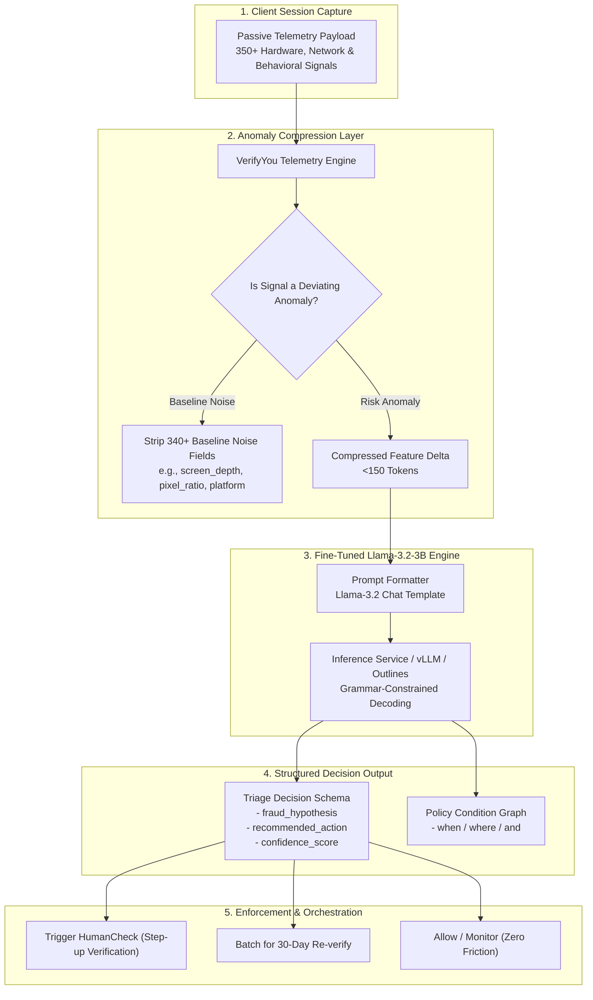

# 🦙 VerifyYou LLaMA (`verification-llama`)

> **AI-Assisted Trust & Safety (T&S) Telemetry Triage Copilot & Natural Language Policy Compiler powered by lightweight, instruction-tuned LLMs.**

[](https://www.python.org/)
[](https://fastapi.tiangolo.com)
[](https://docs.pydantic.dev/)
[](https://pytorch.org/)
[](https://huggingface.co/)
[](https://huggingface.co/meta-llama/Llama-3.2-3B-Instruct)
[](LICENSE)

---

## 📑 Table of Contents

- [Overview](#-overview)
- [The Problem & The Solution](#-the-problem--the-solution)
- [Key Features](#-key-features)
- [System Architecture](#-system-architecture)
- [Threat & Behavioral Archetypes](#-threat--behavioral-archetypes)
  - [1. Sybil Ban Evader](#1-sybil-ban-evader)
  - [2. Bot Farm Agent](#2-bot-farm-agent)
  - [3. Sleeper Account Takeover (ATO)](#3-sleeper-account-takeover-ato)
  - [4. Privacy Power User (False-Positive Benchmark)](#4-privacy-power-user-false-positive-benchmark)
- [The Anomaly Filter & Feature Compression](#-the-anomaly-filter--feature-compression)
- [Dataset Preparation & Fine-Tuning Pipeline](#-dataset-preparation--fine-tuning-pipeline)
  - [Llama-3.2-3B Chat Template Format](#llama-32-3b-chat-template-format)
  - [Task Types](#task-types)
- [FastAPI Inference Service](#-fastapi-inference-service)
  - [Schema Definitions](#schema-definitions)
  - [API Endpoints](#api-endpoints)
    - [1. Triage Session (`POST /api/v1/triage`)](#1-triage-session-post-apiv1triage)
    - [2. Compile Rule (`POST /api/v1/compile-rule`)](#2-compile-rule-post-apiv1compile-rule)
- [Project Directory Structure](#-project-directory-structure)
- [Getting Started](#-getting-started)
  - [Prerequisites](#prerequisites)
  - [Installation](#installation)
  - [Running the Simulation](#running-the-simulation)
  - [Generating Training Datasets](#generating-training-datasets)
  - [Starting the API Server](#starting-the-api-server)
  - [Testing Endpoints with cURL](#testing-endpoints-with-curl)
- [Production Architecture & Constrained Decoding](#-production-architecture--constrained-decoding)
- [Roadmap](#-roadmap)
- [Contributing & License](#-contributing--license)

---

## 💡 Overview

Modern digital platforms face an unprecedented wave of automated abuse: coordinated bot farms, multi-accounting sybils, credential stuffing, and sleeper account takeovers (ATO). While passive telemetry systems collect hundreds of rich hardware and network indicators, translating raw, noisy signals into actionable trust decisions in real-time remains a major bottleneck for Trust & Safety (T&S) engineering teams.

**`verify-you-llama`** bridges this gap. It is a specialized, end-to-end framework designed to compress high-dimensional telemetry (350+ passive client signals) into compact feature deltas and feed them into a fine-tuned, low-latency language model (**Llama-3.2-3B-Instruct**). 

The system delivers:
1. **Automated Risk Triage:** Instant plain-English fraud hypotheses paired with deterministic policy actions and calibrated confidence scores.
2. **False-Positive Mitigation:** Accurate distinction between malicious evasion and legitimate privacy tools (VPNs, canvas blockers, password managers).
3. **Natural Language Policy Compilation:** Real-time translation of plain-English security rules into executable `When / Where / And` condition workflow graphs.

---

## 🔍 The Problem & The Solution

```
┌────────────────────────────────────────────────────────────────────────┐
│                              THE PROBLEM                               │
│                                                                        │
│   Client Payload (350+ Raw Signals)                                    │
│   ├── Noise: screen depth, pixel ratio, language, hardware concurrency │
│   ├── Latency: Feeding raw payloads to frontier LLMs costs >$0.02/req  │
│   │            and exceeds 1,500 tokens per evaluation.                │
│   └── False Positives: Privacy users (Mullvad, Brave) get flagged as  │
│                        bots due to basic heuristics.                   │
└───────────────────────────────────┬────────────────────────────────────┘
                                    │
                                    ▼
┌────────────────────────────────────────────────────────────────────────┐
│                              THE SOLUTION                              │
│                                                                        │
│   VerifyYou Telemetry Engine + Llama-3.2-3B Copilot                    │
│   ├── Anomaly Filter: Strips 340+ noise fields -> Feature Delta        │
│   │                  (<150 tokens, sub-millisecond compression).       │
│   ├── Edge LLM (Llama-3.2-3B): Fine-tuned with structured outputs.     │
│   ├── Guaranteed JSON Schema via Pydantic & Grammar Constraints.       │
│   └── False-Positive Aware: Trained on verified privacy archetypes.    │
└────────────────────────────────────────────────────────────────────────┘
```

---

## ✨ Key Features

- **High-Dimension Telemetry Engine (`telemetry_generator.py`)**:
  Simulates passive telemetry sessions comprising 350+ signals including hardware fingerprints, behavioral mouse entropy, keystroke cadence, Tor/VPN exit indicators, ASN classifications, and cross-network fraud tags.
- **Noise-Stripping Anomaly Filter**:
  Isolates actionable behavioral deviations from baseline device characteristics, shrinking context window consumption by **>90%** (under 150 tokens).
- **Llama-3.2-3B Instruct Pipeline (`prepare_dataset_and_train.py`)**:
  Generates golden synthetic datasets formatted according to Meta's Llama-3.2 chat template (`<|begin_of_text|><|start_header_id|>...`), ready for QLoRA fine-tuning with Unsloth or Hugging Face TRL.
- **Production REST API (`inference_server.py`)**:
  Built with FastAPI and Pydantic v2, enforcing strict schema compliance with validation for confidence scores, enumerated actions, and workflow condition graphs.
- **Dual Operational Modes**:
  - **Triage Mode**: Ingests session anomalies and issues triage decisions (`Trigger HumanCheck`, `Batch for 30-day Re-verify`, `Allow / Monitor`).
  - **Compiler Mode**: Converts human-written policies (e.g. *"Step up any checkout from a datacenter IP over $300"*) into executable logic graphs.

---

## 🏗 System Architecture

The following diagram illustrates the flow of telemetry data from client-side capture through anomaly compression, structured inference, and policy execution:



---

## 🎭 Threat & Behavioral Archetypes

The telemetry generator models 4 distinct real-world behavioral archetypes to validate triage discrimination and eliminate false positives:

### 1. Sybil Ban Evader
- **Characteristics**: Fresh device profile, routing through Tor exit nodes, automated 140ms form filling, active cross-network abuse history, high copy-paste count.
- **Risk Profile**: **Critical**. Indicates an attacker attempting to circumvent a prior ban by spinning up disposable accounts.
- **Expected Action**: `Trigger HumanCheck` (Confidence: `0.96`).

### 2. Bot Farm Agent
- **Characteristics**: Datacenter ASN (hosting provider), declared AI agent without verified ownership, unnaturally robotic mouse movement (mouse entropy $\approx 0.04$), sub-100ms form fill, high canvas hash cluster size.
- **Risk Profile**: **High**. Programmatic automation scraping data or conducting credential stuffing.
- **Expected Action**: `Trigger HumanCheck` (Confidence: `0.95+`).

### 3. Sleeper Account Takeover (ATO)
- **Characteristics**: Mature account (194+ days old), new unverified device, impossible geographical velocity (920 km/h indicating travel anomaly), altered keystroke dwell time, sudden payout method modification.
- **Risk Profile**: **High**. Legitimate account hijacked by an unauthorized actor attempting fund exfiltration.
- **Expected Action**: `Trigger HumanCheck` / `Batch for 30-day Re-verify`.

### 4. Privacy Power User (False-Positive Benchmark)
- **Characteristics**: Active VPN (e.g. Mullvad), canvas fingerprint spoofing (e.g. Brave Browser), password manager autofill (210ms), standard human keystroke cadence, clean cross-network flag, aged account.
- **Risk Profile**: **Benign**. Legitimate user taking standard privacy precautions.
- **Expected Action**: `Allow / Monitor` (Confidence: `0.91`).

---

## ⚡ The Anomaly Filter & Feature Compression

Directly prompting an LLM with 350+ JSON fields causes severe token bloat, high latency, and hallucinated correlations. The Anomaly Filter (`extract_feature_deltas` in `telemetry_generator.py`) filters static hardware noise while preserving all Key Risk Indicators (KRIs):

```
Raw Payload (360+ keys, ~1,800 tokens)
                  │
                  ▼  [Anomaly Filter]
Filtered Delta (10-12 keys, <150 tokens)
```

### Example Feature Delta Payload
```json
{
  "account_id": "acct_5595",
  "trust_score": 28,
  "device_new": true,
  "tor_exit": true,
  "vpn_exit": false,
  "fast_fill_ms": 140,
  "copy_paste_count": 6,
  "cross_network_flag": true,
  "canvas_spoofed": false,
  "mouse_entropy": 0.89,
  "asn_type": "hosting",
  "vertical": "ai_data_labeling"
}
```

---

## 🧪 Dataset Preparation & Fine-Tuning Pipeline

`prepare_dataset_and_train.py` compiles multi-task golden examples into Hugging Face `Dataset` structures ready for parameter-efficient fine-tuning (PEFT/LoRA) using [Unsloth](https://github.com/unslothai/unsloth) or Hugging Face `trl`.

### Llama-3.2-3B Chat Template Format
Each example is formatted with Meta's official special tokens:

```
<|begin_of_text|><|start_header_id|>system<|end_header_id|>
You are a Trust & Safety triage copilot for VerifyYou. Ingest the following compressed session telemetry delta and output strict JSON with a 1-sentence fraud hypothesis, recommended action, and confidence score.<|eot_id|>
<|start_header_id|>user<|end_header_id|>
Input: {"account_id": "acct_2291", "trust_score": 28, "device_new": true, "tor_exit": true, "fast_fill_ms": 140, "cross_network_flag": true, "vertical": "ai_data_labeling"}<|eot_id|>
<|start_header_id|>assistant<|end_header_id|>
Output: {"fraud_hypothesis": "Likely ban-evasion attempt: new device, Tor exit node, and automated 140ms form fill matching a cross-network fraud flag.", "recommended_action": "Trigger HumanCheck", "confidence_score": 0.96}<|eot_id|>
```

### Task Types

| Task | Purpose | Input | Expected Output |
| :--- | :--- | :--- | :--- |
| `triage_classification` | Automated session risk assessment | Account ID + Feature Deltas | Hypothesis, Action, Confidence Score |
| `rule_compiler` | Policy-as-code translation | Natural language safety rule | Structured When/Where/And condition graph |

---

## 🚀 FastAPI Inference Service

`inference_server.py` exposes high-speed REST endpoints configured with Pydantic v2 validation models.

### Schema Definitions

```python
class TriageResponse(BaseModel):
    fraud_hypothesis: str = Field(..., description="1-sentence plain-English explanation of the risk pattern.")
    recommended_action: str = Field(..., description="Must be one of: Trigger HumanCheck, Batch for 30-day Re-verify, Allow / Monitor")
    confidence_score: float = Field(..., ge=0.0, le=1.0)

class RuleCompilerResponse(BaseModel):
    workflow_graph: Dict[str, Any] = Field(..., description="Structured When/Where/And visual workflow condition graph.")
```

### API Endpoints

#### 1. Triage Session (`POST /api/v1/triage`)
Ingests compressed feature deltas and returns a structured risk evaluation.

- **Request Body**:
  ```json
  {
    "account_id": "acct_2291",
    "feature_deltas": {
      "trust_score": 28,
      "tor_exit": true,
      "cross_network_flag": true,
      "fast_fill_ms": 140
    }
  }
  ```

- **Response Body (`200 OK`)**:
  ```json
  {
    "fraud_hypothesis": "Likely ban-evasion attempt: new device + Tor exit node + automated 140ms form fill matching cross-network fraud flag.",
    "recommended_action": "Trigger HumanCheck",
    "confidence_score": 0.96
  }
  ```

#### 2. Compile Rule (`POST /api/v1/compile-rule`)
Translates natural language security policies into executable condition graphs.

- **Request Body**:
  ```json
  {
    "natural_language_rule": "Step up any checkout from a datacenter IP over $300"
  }
  ```

- **Response Body (`200 OK`)**:
  ```json
  {
    "workflow_graph": {
      "when": {
        "event": "checkout_initiated"
      },
      "where": {
        "asn_type": "datacenter"
      },
      "and": {
        "transaction_amount_usd": {
          ">": 300
        }
      },
      "action": "Trigger HumanCheck"
    }
  }
  ```

---

## 📁 Project Directory Structure

```text
verify-you-llama/
├── data/                         # Local dataset storage (raw payloads, JSONL splits)
│   └── .gitkeep
├── model/                        # Checkpoints, adapter weights (LoRA), GGUF files
│   └── .gitkeep
├── pipeline/                     # ETL, data enrichment, and fine-tuning pipelines
│   └── .gitkeep
├── ui/                           # Frontend dashboard & visual workflow graph builder
│   └── .gitkeep
├── .gitignore                    # Python, virtualenv, and model weight exclusions
├── inference_server.py           # FastAPI service with strict Pydantic triage schemas
├── prepare_dataset_and_train.py  # Dataset compilation & Llama-3.2 chat template formatter
├── requirements.txt              # Core project dependencies
├── telemetry_generator.py        # 350-signal simulation engine & anomaly filter
└── README.md                     # Comprehensive project documentation
```

---

## 🛠 Getting Started

### Prerequisites
- **Python**: Version `3.10` or higher
- **Package Manager**: `pip` or `uv`
- **Optional (for fine-tuning)**: CUDA-enabled GPU (NVIDIA RTX 3090/4090, A100, or Apple Silicon Mac via MPS)

### Installation

1. **Clone the repository**:
   ```bash
   git clone https://github.com/your-username/verify-you-llama.git
   cd verify-you-llama
   ```

2. **Create and activate a virtual environment**:
   ```bash
   python3 -m venv .venv
   source .venv/bin/activate
   ```

3. **Install dependencies**:
   ```bash
   pip install -r requirements.txt
   ```

### Running the Simulation
Execute `telemetry_generator.py` to simulate 350-signal raw payloads across different threat archetypes and observe the anomaly compression in action:

```bash
python telemetry_generator.py
```

*Output sample:*
```text
=== TESTING ARCHETYPE 1: BAN-EVADING SYBIL ===
Total Raw Keys Generated: 361
Compressed LLM Input Payload (Feature Deltas):
{
  "account_id": "acct_5595",
  "trust_score": 28,
  "device_new": true,
  "tor_exit": true,
  "vpn_exit": false,
  "fast_fill_ms": 140,
  "copy_paste_count": 6,
  "cross_network_flag": true,
  "canvas_spoofed": false,
  "mouse_entropy": 0.89,
  "asn_type": "hosting",
  "vertical": "ai_data_labeling"
}
```

### Generating Training Datasets
Build the formatted training samples for Llama-3.2-3B:

```bash
python prepare_dataset_and_train.py
```

### Starting the API Server
Launch the FastAPI development server powered by Uvicorn:

```bash
python inference_server.py
```

The server starts locally at:
- **API Base URL**: `http://127.0.0.1:8000`
- **Interactive Swagger Docs**: `http://127.0.0.1:8000/docs`
- **Alternative ReDoc UI**: `http://127.0.0.1:8000/redoc`

### Testing Endpoints with cURL

#### Test 1: High-Risk Sybil Triage
```bash
curl -X POST "http://127.0.0.1:8000/api/v1/triage" \
     -H "Content-Type: application/json" \
     -d '{
       "account_id": "acct_9981",
       "feature_deltas": {
         "trust_score": 25,
         "tor_exit": true,
         "cross_network_flag": true,
         "fast_fill_ms": 110
       }
     }'
```

#### Test 2: Privacy Power User (Benign Check)
```bash
curl -X POST "http://127.0.0.1:8000/api/v1/triage" \
     -H "Content-Type: application/json" \
     -d '{
       "account_id": "acct_3321",
       "feature_deltas": {
         "trust_score": 75,
         "vpn_exit": true,
         "canvas_spoofed": true,
         "fast_fill_ms": 350,
         "cross_network_flag": false
       }
     }'
```

#### Test 3: Natural Language Policy Compilation
```bash
curl -X POST "http://127.0.0.1:8000/api/v1/compile-rule" \
     -H "Content-Type: application/json" \
     -d '{
       "natural_language_rule": "Step up any checkout from a datacenter IP over $300"
     }'
```

---

## 🔒 Production Architecture & Constrained Decoding

In production environments, generating unstructured free-text with LLMs introduces schema breaking risks. `verify-you-llama` is designed to be paired with **Grammar-Constrained Decoding Engines**:

```
                  ┌────────────────────────────────────────┐
                  │          Inference Controller          │
                  │   (vLLM / Outlines / HuggingFace TGI)  │
                  └───────────────────┬────────────────────┘
                                      │
                      Enforce Context-Free Grammar (CFG)
                        or Strict JSON Schema Decoder
                                      │
                                      ▼
                  ┌────────────────────────────────────────┐
                  │           Llama-3.2-3B Model           │
                  │ Logit masking guarantees 100% valid    │
                  │ JSON conforming to Pydantic schemas.   │
                  └────────────────────────────────────────┘
```

By constraining logits during generation:
- Output is guaranteed to parse into `TriageResponse` or `RuleCompilerResponse`.
- Hallucinated fields or invalid enum choices (`recommended_action`) are mathematically prevented at zero temperature penalty.

---

## 🗺 Roadmap

- [x] **Phase 1**: Passive telemetry generator with 350+ simulated signals.
- [x] **Phase 2**: Anomaly compression filter for sub-150-token inputs.
- [x] **Phase 3**: Golden dataset curation and Llama-3.2-3B chat template formatting.
- [x] **Phase 4**: FastAPI service with Pydantic v2 schemas and mock constrained inference.
- [ ] **Phase 5**: Unsloth fine-tuning notebook for Llama-3.2-3B on consumer GPUs.
- [ ] **Phase 6**: Outlines / vLLM integration for native grammar-guided local inference.
- [ ] **Phase 7**: Real-time Kafka / Redis consumer for streaming session triage.
- [ ] **Phase 8**: Interactive Next.js triage dashboard under `ui/`.

---

## 📄 Contributing & License

Contributions, bug reports, and pull requests are welcome! If you would like to contribute:
1. Fork the repository.
2. Create your feature branch (`git checkout -b feature/new-archetype`).
3. Commit your changes (`git commit -m 'feat: add credential stuffing archetype'`).
4. Push to the branch (`git push origin feature/new-archetype`).
5. Open a Pull Request.

Distributed under the **MIT License**. See `LICENSE` for more information.
